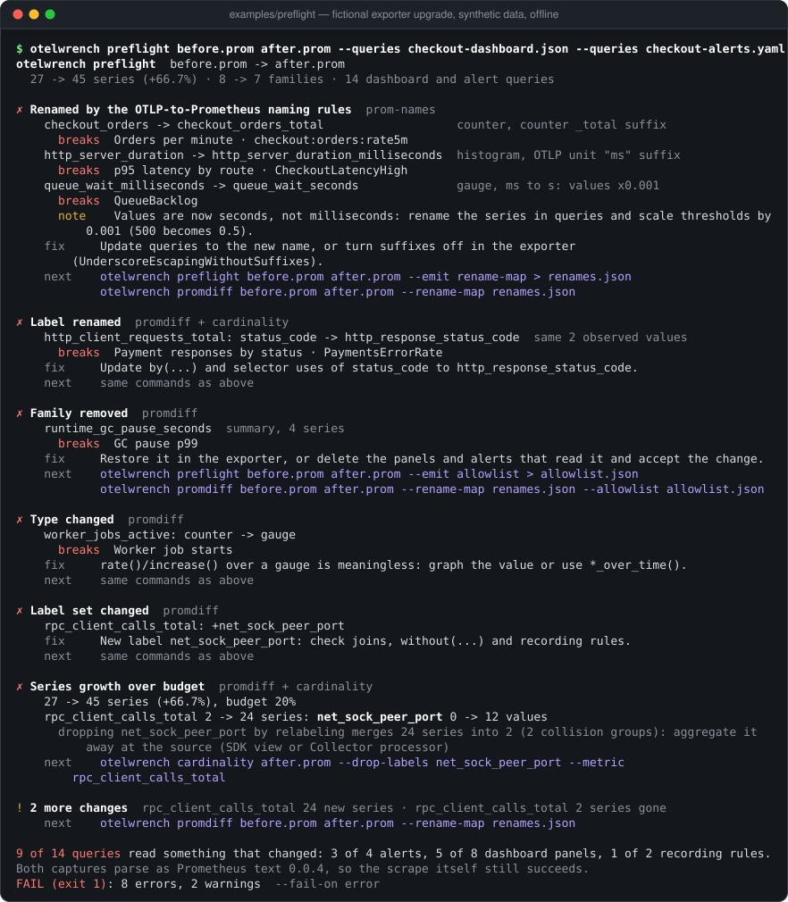

<p align="center">
  <picture>
    <source media="(prefers-color-scheme: dark)" srcset="assets/logo-dark.svg">
    
  </picture>
</p>

<p align="center">
  <strong>Catch the telemetry change that scrapes fine and silently breaks your dashboards and alerts.</strong><br>
  One offline CLI for OpenTelemetry and Prometheus pipelines: metrics, traces, logs and alerts, checked on saved files.
</p>

<p align="center">
  <a href="https://pypi.org/project/otelwrench/"></a>
  <a href="https://pypi.org/project/otelwrench/"></a>
  <a href="LICENSE"></a>
</p>

<p align="center">
  English · <a href="README.zh-CN.md">简体中文</a>
</p>

<p align="center">
  <strong>An exporter upgrade whose <code>/metrics</code> still parses and scrapes cleanly breaks 9 of 14 dashboard panels and alerts. <code>preflight</code> flags all 9, and none of the 5 that still work.</strong><br>
  <sub>Fictional, synthetic example: two <code>/metrics</code> captures, an 8-panel dashboard and a 6-rule alert file, scored against a hand-written oracle. A syntax check accepts both captures; <code>promdiff</code> alone reports 4 "removed" families, 3 of which are suffix renames. <a href="benchmarks/preflight/results.json">Stored result</a> · <a href="benchmarks/preflight/README.md">method</a> · reproduce with <code>python3 benchmarks/preflight/run.py</code>.</sub>
</p>

```sh
uvx otelwrench preflight before.prom after.prom --queries dashboard.json --queries alerts.yaml   # or: pipx install otelwrench
```

<p align="center">
  
</p>
<p align="center"><sub>Real output on the bundled example (<code>examples/preflight</code>, fictional service, no network). Regenerate with <code>assets/render_terminal.py</code>.</sub></p>

## Quick start

Capture `/metrics` before and after the change (an exporter, SDK or Collector upgrade, a new
instrumentation library, a config change), then:

```sh
uvx otelwrench preflight before.prom after.prom                         # schema, renames, growth
uvx otelwrench preflight before.prom after.prom \
    --queries grafana-dashboard.json --queries alert-rules.yaml         # + which queries break
uvx otelwrench preflight before.prom after.prom --format json           # otelwrench.preflight/v1
```

No collector, backend, account or network access. To run the demo above from a clone:

```sh
git clone https://github.com/tianhaogutum/otelwrench && cd otelwrench/examples/preflight
uvx otelwrench preflight before.prom after.prom --queries checkout-dashboard.json --queries checkout-alerts.yaml
```

Exit status: `0` nothing at or above `--fail-on` (default `error`), `1` findings at or above
it, `2` usage or input error. `--queries` reads Grafana dashboard JSON, Prometheus rule files
(including `PrometheusRule` resources) and plain one-query-per-line files.

## What `preflight` checks

| Finding | Why it hurts | Detected by | Next command it prints |
| --- | --- | --- | --- |
| Family renamed by the OTLP naming rules (`_seconds`, `_milliseconds`, `_bytes`, `_ratio`, `_total`, ms → s) | Queries on the old name return nothing; alerts never fire. ms → s also needs thresholds × 0.001 | [`prom-names`](docs/prom-names.md) naming function | `--emit rename-map`, then `promdiff --rename-map` |
| Label renamed (same values, new name) | `by (old_label)` and `{old_label=...}` stop matching | `promdiff` schema diff + `cardinality` label values | same |
| Family removed | Panels go empty | [`promdiff`](docs/promdiff.md) | `--emit allowlist`, then `promdiff --allowlist` |
| Type changed (counter ↔ gauge, ...) | `rate()` over a gauge, raw graphs of a counter | `promdiff` | same |
| Label set changed | Removed labels break grouping; added labels change joins | `promdiff` | same |
| Series growth over budget (default 20%) | Cost and series limits; names the label behind it and whether dropping it would merge series | `promdiff` + [`cardinality`](docs/cardinality.md) | `cardinality --drop-labels ... [--emit-config]` |

Renames are projected before comparing, exactly like `promdiff --rename-map`, so a renamed
family is reported once, as a rename, and the other findings describe what changed besides
the name. The emitted rename map and allowlist turn into a plain `otelwrench promdiff` CI
gate that passes until something else changes. Details: [docs/preflight.md](docs/preflight.md).

## All commands

| | Command | What it does | Docs |
| --- | --- | --- | --- |
| **Metrics** | `preflight` | One CI verdict on a before/after `/metrics` pair, with the queries each change breaks and the next command | [preflight](docs/preflight.md) |
| | `prom-names` | What OTLP gauge/sum metric and label names become in Prometheus: unit suffixes, escaping, collisions | [prom-names](docs/prom-names.md) |
| | `promdiff` | Gate two `/metrics` snapshots on removed families, type and label-schema changes and series growth | [promdiff](docs/promdiff.md) |
| | `cardinality` | What-if label removal on saved scrapes: series saved, collisions created, candidate relabel rule | [cardinality](docs/cardinality.md) |
| **Traces** | `tracepack` | Convert saved traces between OTLP, Jaeger and Zipkin JSON with loss reports and hash-verified bundles | [tracepack](docs/tracepack.md) |
| | `tracediff` | Diff two trace corpora by operation latency and parent/child topology, with CI budgets | [tracediff](docs/tracediff.md) |
| | `spanmetrics` | Derive the RED metrics a spanmetrics connector would produce from saved traces; compare dimension sets | [spanmetrics](docs/spanmetrics.md) |
| | `tailsim` | Replay tail-sampling policies on saved traces and compare what two policies keep | [tailsim](docs/tailsim.md) |
| **Logs** | `loki` | Preview how Loki maps OTLP log attributes to stream labels and structured metadata; compare profiles | [loki](docs/loki.md) |
| **Alerts** | `alert-flapsim` | Replay alert rules over a saved `query_range` matrix; compare thresholds and `for`/`keep_firing_for` | [alert-flapsim](docs/alert-flapsim.md) |
| **Migration** | `sentry` | Convert saved Sentry SDK envelopes to OTLP JSON logs and traces with a loss manifest | [sentry](docs/sentry.md) |

`otelwrench <command> --help` lists every subcommand and option. Each command has runnable
examples in `examples/<command>/`.

## Quick start by group

### Metrics

```sh
otelwrench prom-names convert examples/prom-names/metrics.json --output out.prom    # OTLP JSON -> Prometheus names
otelwrench promdiff examples/promdiff/before.prom examples/promdiff/breaking.prom   # exit 1: breaking change
otelwrench cardinality examples/cardinality/collisions.prom --drop-labels pod --emit-config
```

### Traces

```sh
otelwrench tracepack convert examples/tracepack/zipkin.json --from zipkin --to otlp --output out.json
otelwrench tracediff examples/tracediff/baseline.json examples/tracediff/regression.json \
  --config examples/tracediff/budget.json                                          # exit 1: regression
otelwrench spanmetrics examples/spanmetrics/traces.json --buckets 0.1,0.5,1 --output out.prom
otelwrench tailsim compare examples/tailsim/traces.json \
  --baseline examples/tailsim/baseline.yaml --candidate examples/tailsim/policy.yaml
```

### Logs, alerts, migration

```sh
otelwrench loki compare examples/loki/logs.json --before examples/loki/defaults.yaml --after examples/loki/loki.yaml
otelwrench alert-flapsim replay examples/alert-flapsim/query-range.json --config examples/alert-flapsim/alert.json
otelwrench sentry convert examples/sentry/mixed.envelope --dry-run
```

## How it compares

otelwrench works on files you saved: `/metrics` captures, trace exports, log batches,
`query_range` results. It runs before a change is deployed, in CI or on a laptop, and does not
replace your collector, backend or query-time linting.

| You use | It does | otelwrench adds |
| --- | --- | --- |
| `promtool check metrics` | Lints one exposition for naming and format problems | A comparison of two captures: what was renamed, removed or retyped, and which of your queries read it |
| pint (rule linter) | Checks Prometheus rules, including against a live Prometheus | No live server needed: the "after" side can be a capture from a staging pod or a CI job, before any data reaches Prometheus |
| Grafana / Mimir dashboard and rule analysis tools | List the metrics that dashboards and rules use | The other half: which of those metrics changed between two exporter versions, and why (suffix rules, unit rescale, label rename) |
| OpenTelemetry Collector `prometheus` exporter, Prometheus OTLP receiver | Translate OTLP names in production | `prom-names` previews the translation offline; `preflight` catches what it changed after an upgrade |
| Jaeger, Zipkin and OTLP tooling | Store and show traces | Offline conversion with explicit loss reports, trace-shape regression gates, tail-sampling and spanmetrics what-ifs |

## Trust and limits

- **Offline, no telemetry.** No command opens a network connection; inputs are local files.
- **Read-only unless you name an output.** `preflight`, `promdiff` and `cardinality` only print.
  Commands that write take an explicit output path and write atomically.
- **Heuristics are labelled.** `preflight` matches queries by metric and label name, not by
  evaluating PromQL; rename detection covers the OTLP suffix rules and same-valued label
  renames. The headline example is one synthetic upgrade that shows the mechanism, not a
  precision estimate for real dashboards.
- **Tested.** 1,700+ test functions under `tests/`; `.github/workflows/ci.yml` is set up to run them on
  Linux and macOS with Python 3.11 to 3.14.
- **Platforms.** Linux and macOS, Python 3.11+. Windows is untested.

otelwrench is independent and not affiliated with OpenTelemetry, the CNCF, Prometheus,
Grafana Labs, Sentry, Jaeger or Zipkin. Third-party notices: [THIRD_PARTY.md](THIRD_PARTY.md).

## License

Apache-2.0. See [LICENSE](LICENSE) and [NOTICE](NOTICE).

---

<p align="center">If otelwrench caught a rename before your on-call did, a star helps other people find it.</p>
