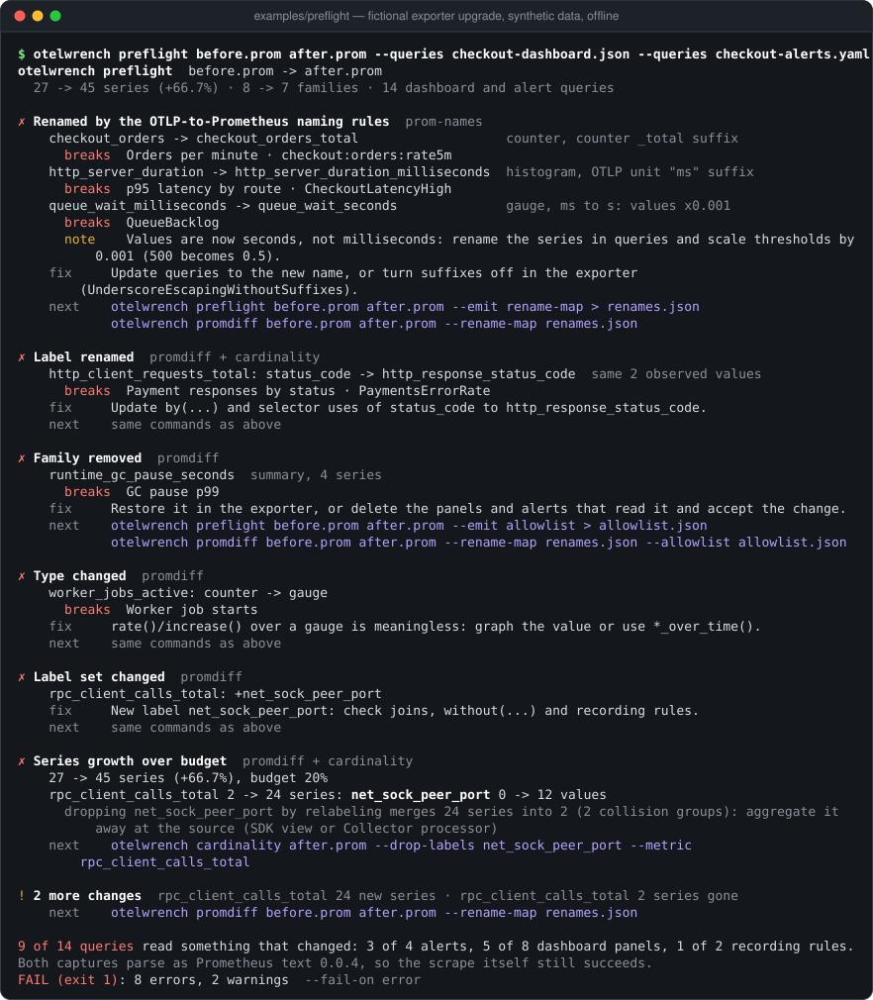

<p align="center">
  <picture>
    <source media="(prefers-color-scheme: dark)" srcset="assets/logo-dark.svg">
    
  </picture>
</p>

<p align="center">
  <strong>抓住那种“照样能抓取、却悄悄弄坏看板和告警”的遥测变更。</strong><br>
  一个面向 OpenTelemetry 和 Prometheus 链路的离线命令行工具：指标、链路、日志、告警，都在保存下来的文件上检查。
</p>

<p align="center">
  <a href="https://pypi.org/project/otelwrench/"></a>
  <a href="https://pypi.org/project/otelwrench/"></a>
  <a href="LICENSE"></a>
</p>

<p align="center">
  <a href="README.md">English</a> · 简体中文
</p>

<p align="center">
  <strong>一次 exporter 升级后，<code>/metrics</code> 照样能解析、能抓取，14 个看板面板和告警里却有 9 个坏了。<code>preflight</code> 把这 9 个全部标出来，另外 5 个仍然正常的一个都没误报。</strong><br>
  <sub>虚构的合成示例：两份 <code>/metrics</code> 抓取、一个 8 面板的看板、一个 6 条规则的告警文件，对照手写的标准答案打分。只做语法检查时两份抓取都能通过；单用 <code>promdiff</code> 会报 4 个“被删除”的指标族，其中 3 个其实是后缀改名。<a href="benchmarks/preflight/results.json">存档结果</a> · <a href="benchmarks/preflight/README.md">方法</a> · 用 <code>python3 benchmarks/preflight/run.py</code> 复现。</sub>
</p>

```sh
uvx otelwrench preflight before.prom after.prom --queries dashboard.json --queries alerts.yaml   # 或：pipx install otelwrench
```

<p align="center">
  
</p>
<p align="center"><sub>仓库自带示例（<code>examples/preflight</code>，虚构服务，不联网）上的真实输出。用 <code>assets/render_terminal.py</code> 重新生成。</sub></p>

## 快速上手

在变更前后各抓一次 `/metrics`（exporter、SDK 或 Collector 升级，换了埋点库，改了配置都算），然后：

```sh
uvx otelwrench preflight before.prom after.prom                         # 结构、改名、序列增长
uvx otelwrench preflight before.prom after.prom \
    --queries grafana-dashboard.json --queries alert-rules.yaml         # 再看哪些查询会坏
uvx otelwrench preflight before.prom after.prom --format json           # otelwrench.preflight/v1
```

不需要 Collector、后端、账号，也不联网。想在本地跑一遍上面的演示：

```sh
git clone https://github.com/tianhaogutum/otelwrench && cd otelwrench/examples/preflight
uvx otelwrench preflight before.prom after.prom --queries checkout-dashboard.json --queries checkout-alerts.yaml
```

退出码：`0` 表示没有达到 `--fail-on`（默认 `error`）的问题，`1` 表示有，`2` 表示用法或输入错误。
`--queries` 支持 Grafana 看板 JSON、Prometheus 规则文件（包括 `PrometheusRule` 资源），以及每行一条查询的纯文本。

## `preflight` 检查什么

| 发现 | 为什么要紧 | 由谁判定 | 给出的下一步命令 |
| --- | --- | --- | --- |
| 指标族按 OTLP 命名规则改了名（`_seconds`、`_milliseconds`、`_bytes`、`_ratio`、`_total`、毫秒换秒） | 用旧名字的查询什么也查不到，告警永远不会触发；毫秒换秒还得把阈值乘 0.001 | [`prom-names`](docs/prom-names.md) 的命名函数 | `--emit rename-map`，再跑 `promdiff --rename-map` |
| 标签改名（取值相同、名字变了） | `by (旧标签)` 和 `{旧标签=...}` 不再匹配 | `promdiff` 结构对比 + `cardinality` 标签取值 | 同上 |
| 指标族被删除 | 面板变空 | [`promdiff`](docs/promdiff.md) | `--emit allowlist`，再跑 `promdiff --allowlist` |
| 类型变化（counter ↔ gauge 等） | 对 gauge 求 `rate()`、直接画 counter 原始值 | `promdiff` | 同上 |
| 标签集合变化 | 删掉的标签让分组失效，新增的标签影响关联查询 | `promdiff` | 同上 |
| 序列增长超出预算（默认 20%） | 成本和序列上限；会指出是哪个标签导致的，以及直接丢掉它会不会合并序列 | `promdiff` + [`cardinality`](docs/cardinality.md) | `cardinality --drop-labels ... [--emit-config]` |

改名会先像 `promdiff --rename-map` 那样投影掉再比较，所以一个改了名的指标族只会作为“改名”报一次，其他发现描述的是名字之外还变了什么。
导出的改名映射和 allowlist 可以直接变成一个普通的 `otelwrench promdiff` CI 门禁，直到再出现别的变化才会失败。
详见 [docs/preflight.md](docs/preflight.md)。

## 全部命令

| | 命令 | 作用 | 文档 |
| --- | --- | --- | --- |
| **指标** | `preflight` | 对变更前后的 `/metrics` 给出一个 CI 结论，附带每项变更弄坏的查询和下一步命令 | [preflight](docs/preflight.md) |
| | `prom-names` | 预览 OTLP gauge/sum 的指标名和标签名进入 Prometheus 后变成什么：单位后缀、转义、冲突 | [prom-names](docs/prom-names.md) |
| | `promdiff` | 对比两份 `/metrics` 快照，在指标族删除、类型或标签结构变化、序列增长时让 CI 失败 | [promdiff](docs/promdiff.md) |
| | `cardinality` | 在保存的抓取上模拟删标签：能省多少序列、会不会撞车，并给出候选 relabel 规则 | [cardinality](docs/cardinality.md) |
| **链路** | `tracepack` | 在 OTLP、Jaeger、Zipkin JSON 之间转换保存的链路，附损失报告和可校验哈希的打包 | [tracepack](docs/tracepack.md) |
| | `tracediff` | 按操作延迟和父子拓扑对比两批链路，并用 CI 预算把关 | [tracediff](docs/tracediff.md) |
| | `spanmetrics` | 从保存的链路推导 spanmetrics connector 会产出的 RED 指标，比较两种维度选择 | [spanmetrics](docs/spanmetrics.md) |
| | `tailsim` | 在保存的链路上重放尾部采样策略，比较两套策略各保留了什么 | [tailsim](docs/tailsim.md) |
| **日志** | `loki` | 预览 Loki 如何把 OTLP 日志属性映射为流标签和结构化元数据，并比较两套配置 | [loki](docs/loki.md) |
| **告警** | `alert-flapsim` | 在保存的 `query_range` 结果上重放告警规则，比较阈值和 `for`/`keep_firing_for` | [alert-flapsim](docs/alert-flapsim.md) |
| **Collector** | `privacy` | 在版本和 SHA-256 都锁定的真实 Collector 二进制里运行流水线的处理器，检查敏感字段是否真的被去掉（需要 `otelwrench[privacy]`） | [privacy](docs/privacy.md) |
| **迁移** | `sentry` | 把保存的 Sentry SDK envelope 转成 OTLP JSON 日志和链路，附完整损失清单 | [sentry](docs/sentry.md) |

`otelwrench <命令> --help` 会列出全部子命令和选项。每个命令在 `examples/<命令>/` 下都有可直接运行的示例。

## 分组快速上手

### 指标

```sh
otelwrench prom-names convert examples/prom-names/metrics.json --output out.prom    # OTLP JSON -> Prometheus 名称
otelwrench promdiff examples/promdiff/before.prom examples/promdiff/breaking.prom   # 退出码 1：有破坏性变更
otelwrench cardinality examples/cardinality/collisions.prom --drop-labels pod --emit-config
```

### 链路

```sh
otelwrench tracepack convert examples/tracepack/zipkin.json --from zipkin --to otlp --output out.json
otelwrench tracediff examples/tracediff/baseline.json examples/tracediff/regression.json \
  --config examples/tracediff/budget.json                                          # 退出码 1：出现回归
otelwrench spanmetrics examples/spanmetrics/traces.json --buckets 0.1,0.5,1 --output out.prom
otelwrench tailsim compare examples/tailsim/traces.json \
  --baseline examples/tailsim/baseline.yaml --candidate examples/tailsim/policy.yaml
```

### 日志、告警、迁移

```sh
otelwrench loki compare examples/loki/logs.json --before examples/loki/defaults.yaml --after examples/loki/loki.yaml
otelwrench alert-flapsim replay examples/alert-flapsim/query-range.json --config examples/alert-flapsim/alert.json
otelwrench sentry convert examples/sentry/mixed.envelope --dry-run
```

### Collector 隐私回放

`privacy` 会运行真实的 Collector 二进制：先安装 extra，再用 `otelwrench privacy pin` 锁定你已有的二进制，或者显式下载锁定的发布版本。

```sh
pip install 'otelwrench[privacy]'
otelwrench privacy install-collector                                               # 显式下载，校验 SHA-256
otelwrench privacy run --config examples/privacy/collector.yaml --pipeline traces \
  --sample examples/privacy/traces.pb --expect examples/privacy/privacy-fails.yaml \
  --out artifacts/privacy                                                          # 退出码 1：敏感信息仍然存在
```

## 和现有工具的关系

otelwrench 处理的是你保存下来的文件：`/metrics` 抓取、链路导出、日志批次、`query_range` 结果。
它在变更上线之前运行，放在 CI 里或者自己电脑上都行，不替代 Collector、后端或查询时的检查。

| 你在用 | 它做的事 | otelwrench 补上的部分 |
| --- | --- | --- |
| `promtool check metrics` | 检查单份 exposition 的命名和格式 | 两份抓取之间的对比：什么改了名、被删了、换了类型，以及哪些查询用到了它 |
| pint（规则检查工具） | 检查 Prometheus 规则，也能对照在线的 Prometheus | 不需要在线服务：“之后”那份可以来自预发 Pod 或 CI 任务，数据还没进 Prometheus 就能查 |
| Grafana / Mimir 的看板与规则分析工具 | 列出看板和规则用到了哪些指标 | 另一半：这些指标在两个 exporter 版本之间变了什么、为什么变（后缀规则、单位换算、标签改名） |
| OpenTelemetry Collector 的 `prometheus` exporter、Prometheus OTLP 接收端 | 在生产环境里转换 OTLP 名称 | `prom-names` 离线预览转换结果；`preflight` 在升级后找出它改了什么 |
| Jaeger、Zipkin、OTLP 相关工具 | 存储和展示链路 | 带明确损失报告的离线转换、链路结构回归门禁、尾部采样和 spanmetrics 的推演 |

## 可信度与边界

- **离线，无遥测。** 所有命令都不发起网络连接，输入都是本地文件。两个例外都需要你显式执行：`privacy run` 会启动你锁定的 Collector 二进制，只通过 127.0.0.1 与它通信；`privacy install-collector` 在你运行它时下载锁定的 Collector 发布版本（安装 otelwrench 时绝不会下载）。
- **不指定输出就只读。** `preflight`、`promdiff`、`cardinality` 只打印结果；需要写文件的命令都要显式给出输出路径，并原子写入。
- **启发式会标明。** `preflight` 按指标名和标签名匹配查询，并不真正执行 PromQL；改名识别覆盖 OTLP 后缀规则和取值相同的标签改名。开头那个例子是一次合成的升级，用来展示机制，不代表对真实看板的准确率。
- **有测试。** `tests/` 下有 1,700 多个测试函数；`.github/workflows/ci.yml` 配置为在 Linux 和 macOS、Python 3.11 到 3.14 上运行它们。
- **平台。** Linux 和 macOS，Python 3.11+。Windows 未测试。

otelwrench 是独立项目，与 OpenTelemetry、CNCF、Prometheus、Grafana Labs、Sentry、Jaeger、Zipkin 均无关联。第三方声明见 [THIRD_PARTY.md](THIRD_PARTY.md)。

## 许可证

Apache-2.0，见 [LICENSE](LICENSE) 和 [NOTICE](NOTICE)。

---

<p align="center">如果 otelwrench 赶在值班同事之前发现了一次改名，点个 star 能让更多人找到它。</p>
